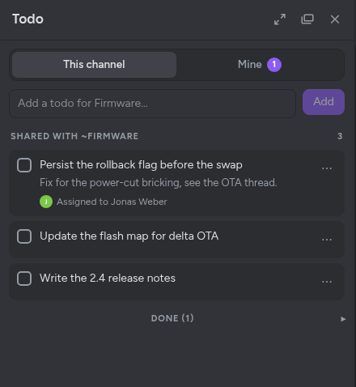

# Antimatter Todo Plugin

Todo lists for [Antimatter](https://github.com/antimatterchat/antimatter): a shared list in every channel, your own
list, and todos you send to people and receive from them, with a daily reminder.



## Using it

Open **Todo** from the app bar (or the channel header). Its panel has two views:

- **This channel**: the channel's todo list, shared by its members. Everyone who can post in the channel adds
  todos, checks them off, edits them, assigns them to a member and moves them to the top; their author and the
  channel's admins delete them. Done todos are folded under the open ones. People who can only read the
  channel (a read-only or archived one) see the list without changing it.
- **Mine**: your own todos, the channel todos assigned to you, the todos people sent you (accept, mark as done
  or decline them), and the ones you sent (remind the person or cancel).

A message's **Add to todo** starts a todo with its text, linked to the message, in the channel's list or your
own. When someone assigns you a channel todo or sends you one, the Todo bot tells you, and its message lets you
answer. Once a day, the bot reminds you of your todos and the ones assigned to you.

The `/todo` command still works: `/todo add`, `/todo list [my|in|out]`, `/todo pop`, `/todo send @someone`,
`/todo settings summary [on|off]` and `/todo settings allow_incoming_task_requests [on|off]`.

## Installation

1. Download the latest release from https://github.com/antimatterchat/antimatter-plugin-todo/releases/latest.
2. Upload it in **System Console > Plugins > Plugin Management**, then enable it.

The plugin keeps its upstream ID, `com.mattermost.plugin-todo`, so the lists of an existing installation carry
over.

## Development

```sh
make dist          # builds the server for every platform, the web app, and the bundle in dist/
make test          # Go and web app tests
make check-style   # golangci-lint, eslint and the type checker
```

Set `MM_SERVICESETTINGS_ENABLEDEVELOPER=1` to build the server for your platform only.

## Documentation

See the [user guide](https://antimatter.chat/docs/users/apps.html#todo) on
[antimatter.chat/docs](https://antimatter.chat/docs/).

## Releases

Pushing a `v*` tag builds the app and publishes it as a
[GitHub release](https://github.com/AntimatterChat/antimatter-plugin-todo/releases) ([release workflow](.github/workflows/release.yml),
using the organisation's shared
[app release workflow](https://github.com/AntimatterChat/.github/blob/main/.github/workflows/app-release.yml)).
`plugin.json` pins the version: bump it first, as the tag must match it. Tags with a `-`, such as `v1.2.0-rc.1`, are published as prereleases. Each release has:

- `com.mattermost.plugin-todo-<version>.tar.gz`: the app bundle, with the server for Linux (amd64, arm64), macOS (amd64, arm64) and Windows (amd64)
- `com.mattermost.plugin-todo-<version>.tar.gz.sig`: its detached signature with the Antimatter plugin signing key
- `SHA256SUMS`: the checksums of the release files

Install the bundle with **Upload Plugin** in **System Console > Plugins > Plugin Management** or
`amctl plugin install-url <bundle URL>` (both need `AM_PLUGINSETTINGS_ENABLEUPLOADS=true`), see
[Installing other apps](https://antimatter.chat/docs/admins/apps.html). A release without `.sig`
files is unsigned (its notes say so): a server with Require Plugin Signature
(`PluginSettings.RequirePluginSignature`) on refuses it. Running the workflow by hand (*Actions* → *Release* → *Run workflow*)
builds the bundle as a workflow artifact, and as a draft prerelease if you tick the box.

## Feedback and support

Found a bug in the Todo plugin, or missing a feature? Please [open an
issue](https://github.com/AntimatterChat/community/issues/new/choose) in the [Antimatter community
repository](https://github.com/AntimatterChat/community), where the feedback for every part of
Antimatter is gathered. Questions and ideas are welcome in its
[Discussions](https://github.com/AntimatterChat/community/discussions). Please report security
problems privately, as explained in the [security
policy](https://github.com/AntimatterChat/.github/blob/main/SECURITY.md).

## Thanks

This plugin started as [mattermost-plugin-todo](https://github.com/mattermost/mattermost-plugin-todo), a community
plugin of the Mattermost ecosystem. Many thanks to the Mattermost community, and to everyone who contributed to
it, for the lists, the requests between people, the daily reminders and the `/todo` command this plugin builds
on.

## License

Apache License 2.0, see [LICENSE](LICENSE).
